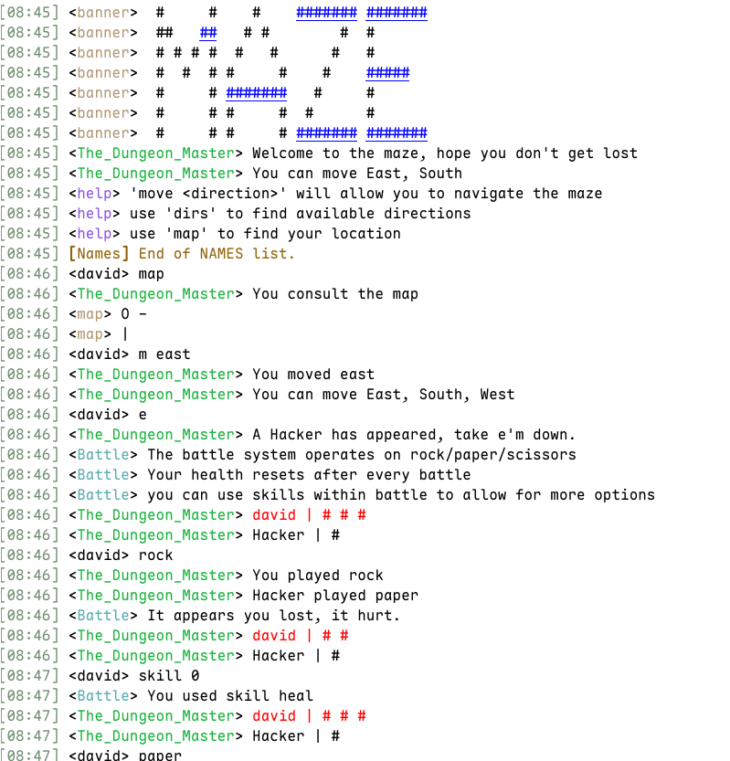

# Irc Maze

An interactive maze accessible as an [IRC](https://en.wikipedia.org/wiki/IRC) server. It uses [twisted](https://twisted.org/) to handle the irc connections.

screenshot taken using [Konversation](https://konversation.kde.org/)

